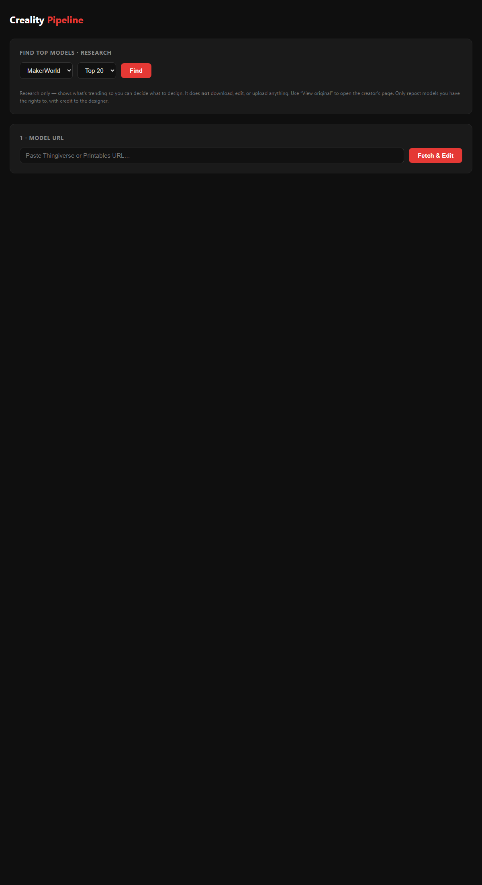

# Creality Pipeline

A Python / FastAPI pipeline that turns 3D-print model pages (Thingiverse, Printables, MakerWorld) into published **Creality Cloud** listings.



## What it does
1. **Discover** — research panel that lists the most popular models on a site (read-only; no download/upload).
2. **Fetch & Edit** — downloads a model's images and STL/CAD file, then **100% locally** (no API, no keys, free forever):
   - keeps the product's colors and detail EXACTLY as-is (blue stays blue, blue+green stay blue+green),
   - sharpens sources that were blurry (unsharp pass on product pixels only),
   - replaces the background with a **procedural wooden studio backdrop** (removes all original background text/watermarks),
   - refuses to save any composite that fails its built-in sharpness/color QA.
   You then tick exactly which edited images you want to upload.
3. **Publish** — drives your real Chrome (via CDP, `--remote-debugging-port=9222`) to fill the Creality Cloud upload form and submit.

## What you MUST provide before it will run
1. **Python 3.10+** installed on your machine.
2. **Google Chrome** browser installed (the upload step drives your real Chrome via CDP).
3. **One-time logins** in that Chrome window to **MakerWorld** and **Creality Cloud** (so the uploader can reuse your sessions).
4. **Playwright's Chromium** browser (downloaded below).

**No API keys. No accounts. No usage costs. Ever.** Image editing is fully local
(OpenCV + the open-source U2Net model via `rembg`, which is downloaded once and
then works offline forever).

## Step-by-step setup
```bash
# 1. Clone the repo
git clone https://github.com/hreyner7-collab/creality-pipeline.git
cd creality-pipeline

# 2. Create a virtual environment (recommended)
python -m venv .venv
.venv\Scripts\activate        # Windows  (use: source .venv/bin/activate on macOS/Linux)

# 3. Install Python dependencies
pip install -r requirements.txt

# 4. Install the Playwright Chromium browser
playwright install chromium

# 5. Log in once (in Chrome) to MakerWorld and Creality Cloud
#    The uploader reuses these sessions from the Chrome debug profile.

# 6. Run the dashboard
python main.py
#    open http://localhost:8000 in your browser
```

## How to use the dashboard
1. **Find Top Models** (optional research) — pick a site, click *Find*, browse trending models.
2. **Model URL** — paste a Thingiverse / Printables / MakerWorld URL, click *Fetch & Edit*.
3. **Preview** — compare original vs edited (red, clean background) and **tick which images to upload** (Select all / Select none / per-image).
4. **Publish to Creality Cloud** — click *Upload to Creality Cloud* (drives Chrome, fills the form; log in if prompted, then confirm the final Submit).

## Never publishes the same model twice
Every model the pipeline publishes is written into a permanent ledger
(`artifacts/published_models.json`) and checked **before anything is uploaded**,
by hand or by a run — so the same model can never be published twice, in a later
run or after a restart. A model is recognised by any one of: its source link, its
Creality listing, its name + designer, or the model file's own fingerprint (the
same geometry re-listed under a new name and URL is still the same model). At
startup the ledger also reads your own Creality account and learns every model
already on it, plus every earlier run log on disk. It lives at
`artifacts/published_models.json` inside the project (not ignored by git), so it
survives restarts and updates; a run filters those models out DURING discovery,
so a finished model is not even looked at again. A model that FAILED stays
retryable; only successes are locked. `POST /published/forget {match}` is the one
way to make an entry publishable again (e.g. you deleted the listing) — it is
not on the dashboard on purpose, so nothing there can unlock a model by accident.

## Structure
- `main.py` — FastAPI app + dashboard routes
- `ledger.py` — permanent "already published" memory (never uploads twice)
  · `GET /published` lists it, `POST /published/forget {match}` unlocks one entry
- `discover.py` — trending-model research scraper
- `downloader.py` — fetches images + model files from source sites
- `editor.py` — fully local editor: text removal, red recolor, studio background
- `uploader.py` — Creality Cloud upload via Chrome CDP
- `creality/index.html` — dashboard UI
- `PLAN.md` — runbook + verification plan

## Notes
- The upload step reuses your logged-in MakerWorld / Creality sessions from the Chrome debug profile, so log in once in that window.
- Only repost models you have the rights to, with credit to the original designer.
- Set `CREALITY_NO_SUBMIT=1` to fill the form but stop before the final Submit.
